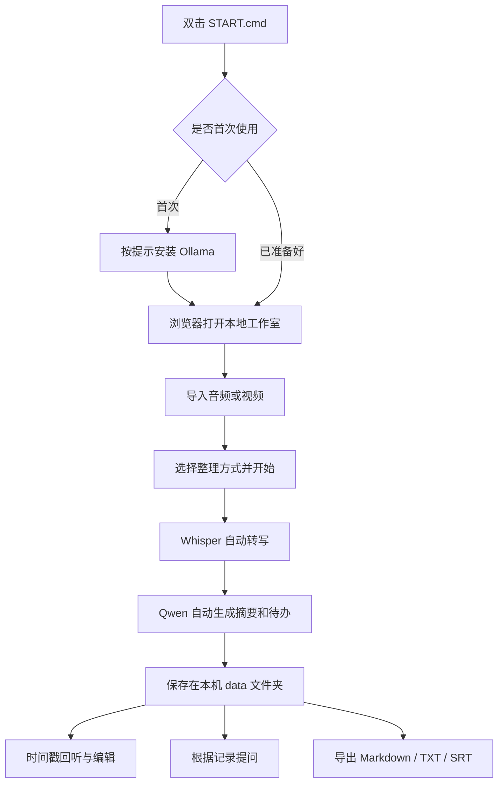
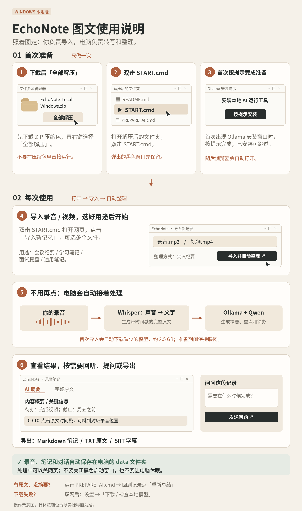

# EchoNote Local

把录音整理成可以回听、编辑、提问和导出的笔记。

这是一个借助 AI 辅助开发的本地语音笔记项目，面向个人会议、学习和录音整理。浏览器提供操作界面，Python 在本机执行语音识别，Ollama 在本机执行文本总结与问答。

## 使用流程图



首次使用会联网下载缺少的模型；准备完成后，本地文件处理可离线运行。下载和处理期间保持启动窗口打开。

## 图文操作说明



更多文档：[功能思维导图](docs/mindmap.md) · [Windows 安装与排错](docs/windows-install.md) · [验证记录](VALIDATION.md) · [第三方组件](THIRD_PARTY.md)

## 已实现

- 批量导入本地音频、视频，或粘贴已有文字。
- 使用 faster-whisper small 模型、CPU int8 进行带时间戳的转写。
- 使用本地 Ollama + Qwen2.5 3B 自动生成摘要、关键信息和待办。
- 通用笔记、会议纪要、学习笔记、面试复盘四种整理方式。
- 点击时间戳回听；编辑原文后清除旧摘要和旧问答，防止内容错配。
- 根据当前记录提问；导出 Markdown、TXT、SRT。
- SQLite 保存记录；任务排队；出错或关闭程序后保留已完成内容。

待办的原文引用会经过匹配检查，负责人和截止时间字段只保留能在原文找到的表述。模型仍可能遗漏或误解内容，重要信息需要核对原文。

## Windows 快速开始

建议 Windows 10/11 x64、16 GB 内存，预留至少 10 GB 磁盘空间。

1. 下载或克隆源码，将整个项目解压到普通文件夹。
2. 双击 `START.cmd`。启动器在项目内准备独立 Python 3.12，不修改系统 Python。
3. 未安装 Ollama 时，按官方安装器提示完成安装。
4. 浏览器自动打开后，可以导入 `samples/chinese-demo.mp3` 进行首次测试。

语音模型约 500 MB，默认文本模型约 2 GB，Ollama 安装需要额外空间。首次下载需要能访问官方模型服务。之后不用 API Key，不产生云端 API 调用费；本地运行会占用电脑内存与 CPU。

源码仓库不包含整套 Python 运行环境和模型，首次启动会下载。`compat-wheels/` 仅包含修复 Windows 兼容性所需的官方 setuptools 小型轮子。

## Windows 兼容性修复

CTranslate2 4.6.0 的 Windows DLL 加载分支需要 `pkg_resources`。项目固定 `setuptools==80.9.0`，并提供经过 SHA-256 校验的离线兼容轮子。启动器在导入语音引擎之前执行 `ensure_compat.py`，通过 `check_audio.py` 区分 Python 模块缺失与 DLL 运行库问题。

如果已有转写原文、但总结模型未准备好，运行 `PREPARE_AI.cmd`，再回到记录点击“重新总结”。

## 数据与隐私

应用仅监听 `127.0.0.1`。文件和笔记保存在本机 `data/`，总结和问答只访问本机 Ollama。首次下载环境和模型需要联网。

`data/`、日志、运行环境、下载缓存和模型权重已经加入 `.gitignore`。备份笔记时先停止应用，再复制 `data/`。不要将真实录音、笔记数据库或含敏感内容的日志提交到仓库。

## 代码结构

| 位置 | 用途 |
| --- | --- |
| `app/web/` | 中文网页界面，离线使用，无外部前端资源依赖 |
| `app/server.py` | 本地接口、文件导入、音频回放和导出 |
| `app/store.py` | SQLite 记录与任务状态 |
| `app/tasks.py` | 串行任务队列和失败恢复 |
| `app/engine.py` | Whisper 转写、Ollama 总结与问答 |
| `bootstrap.ps1` | Windows 首次准备与启动 |
| `ensure_compat.py` / `check_audio.py` | 兼容组件修复及真实导入检查 |
| `tests/` | 保存、恢复、导出、来源检查和内容匹配测试 |
| `docs/` | 思维导图、图文说明与安装文档 |

## 开发与验证

```bash
python -m venv .venv
# Windows: .venv\Scripts\activate
# macOS/Linux: source .venv/bin/activate
python -m pip install -r requirements.txt pytest
python check_audio.py
python -m pytest -q tests
python run.py --no-browser
```

本地 AI 功能需要安装 Ollama 并准备 `qwen2.5:3b` 模型。测试使用模拟引擎验证后端流程，不要求下载模型；真实模型测试单独记录在 `VALIDATION.md`。

## 当前边界

支持本地音频、视频与文字，暂不支持视频平台链接抓取、说话人分离、跨设备同步或手机直接访问电脑服务。单文件限制 2 GB；处理速度和准确率取决于电脑与录音质量。

项目已有 Linux 实际模型与网页流程验证；Windows 依赖问题根据实际启动反馈修正。仓库提供 Windows / Linux 自动检查配置，不能把尚未运行的 CI 当作已经通过的结果。
