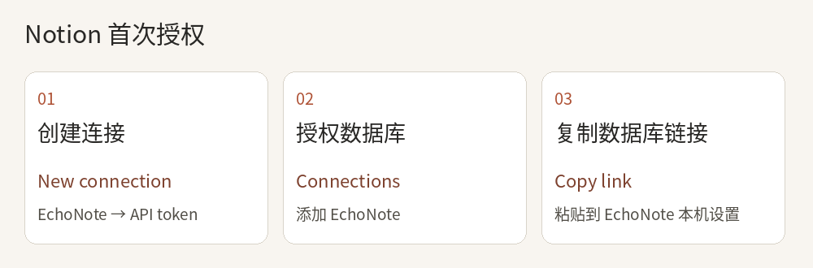
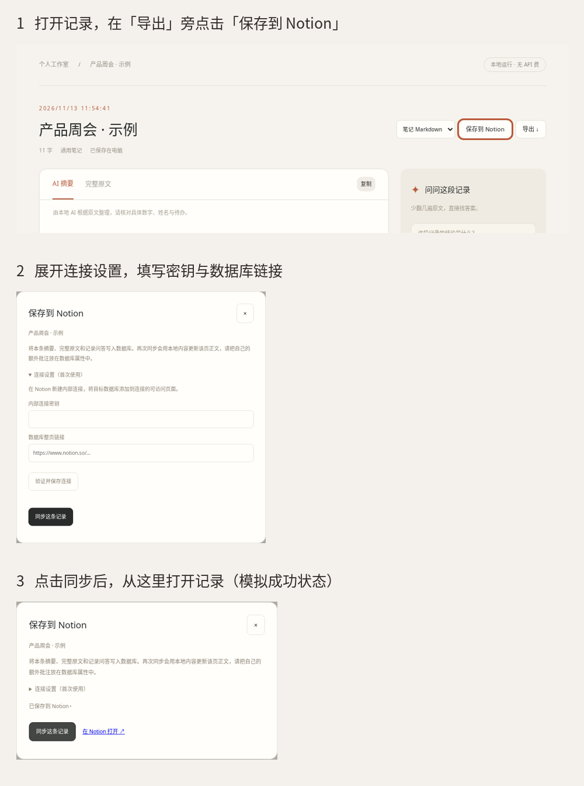

# 把 EchoNote 记录保存到 Notion

[下载完整项目](https://github.com/hyaa-debug/echonote-local/archive/refs/heads/main.zip)，解压后双击 `START.cmd`。本地转写和总结可以独立使用；想在手机或其他电脑上查看文字时，再连接 Notion。

## 一次性设置

1. **建一张表。** 在自己的 Notion 工作区创建整页表格数据库，例如「面试复盘」。保留默认的名称列即可。打开数据库本身，点右上角 `··· → Copy link`，留好链接。
2. **创建 EchoNote 连接。** 打开 [Notion 连接管理页](https://www.notion.so/my-integrations)，选 `New connection`。在 `Connection name` 填 `EchoNote`，选 `API token`，再点 `Create connection`。工作区选择上一步建表的那个。连接需要读取、插入和更新内容权限。
3. **授权这张表。** 在连接的访问设置中添加目标数据库，或打开数据库，点 `··· → Connections / Add connections → EchoNote` 并确认。若桌面端显示 Offline，等数据库同步后用网页版操作。
4. **填入 EchoNote。** 打开一条已转写的记录，点「保存到 Notion」，展开「连接设置」，填入内部连接密钥和数据库整页链接，点「验证并保存连接」。密钥只填在本机 EchoNote，存放于本机笔记数据库。请勿将密钥或 data 备份提交到 GitHub。

## 保存与查看

点「同步这条记录」，看到「已保存到 Notion」后点「在 Notion 打开」。图中使用演示笔记，成功状态由模拟接口返回。数据库中每条笔记对应一页，标题、摘要、原文、已有问答会同步，音频保存在电脑上。修改本地记录后再次同步，会更新同一数据库里的原页正文；自己写在 Notion 的批注请放到单独的数据库属性中。

| 遇到的提示 | 操作 |
| --- | --- |
| 找不到目标 | 确认连接和数据库属于同一个工作区，目标数据库已授权，粘贴的是数据库整页链接。 |
| 密钥无效或权限不足 | 从该连接重新复制密钥，检查读取、插入、更新权限，再验证。 |
| 请选择只包含一个数据源的数据库 | 新建一个普通空白表格数据库并授权。 |
| 连接失败 | 检查网络后重试；本机录音和笔记仍可打开。 |
